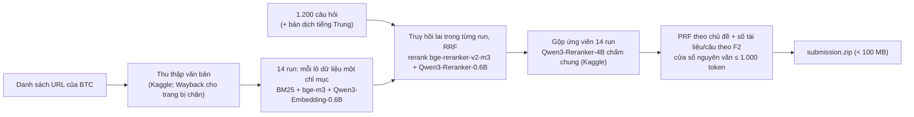

# AncientWings — ViBioMIR (R2AI2026 vòng 3)

Hệ thống truy hồi tài liệu y sinh đa ngôn ngữ cho 1.200 câu hỏi y khoa tiếng Việt: mỗi câu trả về danh sách tài liệu
(`doc_id` trong danh sách của BTC) và các đoạn nguyên văn (`chunk_text`). Không fine-tune, chỉ dùng mô hình mở.

| Bài nộp | FINAL | DOCS_F2 | CHUNKS_F2 |
|---|---|---|---|
| **Bài chính** (`prf/f2_x50_rx`) | **0,3060** | 0,3381 | 0,2739 |
| Dự phòng (`prf/f2_x50_1050`) | 0,3055 | 0,3375 | 0,2734 |
| Thêm Qwen3-Reranker-8B (`prf/f2_x50_rx_8b2`) | chưa có điểm public | | |
| Thêm tài liệu tiếng Anh (`prf/f2_x50_rx_en`) | 0,3009 | 0,3323 | 0,2695 |

Điểm public leaderboard. Phương pháp, phân tích và các thử nghiệm: **báo cáo thuyết minh (PDF) nộp kèm**.
Dữ liệu đã thu thập: https://huggingface.co/datasets/AncientWings/AncientWings_R2AI_STAGE3_ds

## Hệ thống làm gì



1. **Mỗi lô dữ liệu thành một run** (`scripts/pipeline.py`): chuẩn hoá, chia chunk 320/80/768 token, chỉ mục BM25 và
   2 chỉ mục vector, truy hồi bằng câu gốc + từ khoá + bản dịch (Qwen3-4B), gộp RRF, rerank bằng 2 mô hình nhỏ.
2. **Gộp và chấm chung**: mỗi run góp các tài liệu đầu của nó (`export_pool_pairs.py`), Qwen3-Reranker-4B chấm mọi
   cặp (câu hỏi, đoạn) trên Kaggle, nên điểm của các run so được với nhau. Điểm đoạn = 0,5·4B + 0,5·rerank nhỏ;
   điểm tài liệu = đoạn tốt nhất.
3. **Dựng bài nộp** (`prf_rerank.py`, không cần GPU): xếp lại theo chủ đề của 10 tài liệu đầu (PRF, bge-m3), chọn
   số tài liệu từng câu cho F2 kỳ vọng lớn nhất (trung bình 190, trong khoảng 60–400), cắt một cửa sổ nguyên văn
   ≤ 1.000 token quanh đoạn tốt nhất (thêm cửa sổ thứ hai cho 50 tài liệu đầu), nén LZMA (`rezip_lzma.py`).

## Mã nguồn

| Bước | File |
|---|---|
| Thu thập | `notebooks/crawl_corpus_kaggle_hf_upload.ipynb` (crawl trên Kaggle, đẩy lên HF), `merge_ids.py` (gộp file thành nguồn của một run), `fetch_pubmed.py` (tiếng Anh: tiêu đề + tóm tắt PubMed qua NCBI E-utilities) |
| Trang bị chặn (Wayback) | `slug_retrieval.py`, `slug_rerank.py`, `slug_targets.py`, `notebooks/archive_fetch_kaggle.ipynb` |
| Pipeline từng run | `scripts/pipeline.py` gọi lần lượt `prepare.py`, `chunk.py`, `benchmark.py`, `translate.py`, `index.py`, `retrieve.py`, `submit.py`; thư viện ở `src/vibiomir/` |
| Chấm Qwen3-Reranker-4B / 8B | `export_pool_pairs.py` (+ `export_rerank_candidates.py`), `notebooks/rerank_kaggle.ipynb`, `notebooks/rerank_8b_kaggle.ipynb`, `rerank_worker.py` |
| Dựng bài nộp | `prf_rerank.py` (+ `build_rerank_submission.py`, `make_submission.py`, `merge_submissions.py`), `rezip_lzma.py` |
| Kiểm tra | `chunk_stats.py`, `compare_submissions.py`, `rank_drop.py`, `collect_manifests.py` |
| Cấu hình đã chạy | `system_submission/manifests/`: lệnh và tham số của mọi bước (`<run>/stages/*.json`, `pairs_manifest.json`, `prf_manifest.json`...), danh sách ở `INDEX.md` |

Không có file cấu hình riêng: mọi tham số là cờ dòng lệnh, giá trị mặc định đúng với bài nộp chính.

## 1. Cài đặt

Đã chạy trên Windows 11 + PowerShell (Linux: thay `.\env\Scripts\python.exe` bằng `env/bin/python`), Python 3.10+.
Dựng bài nộp chỉ cần CPU, RAM 16 GB. Chạy lại pipeline cần GPU NVIDIA ≥ 4 GB (đội dùng RTX 2050) và Kaggle GPU T4×2.

```powershell
git clone https://github.com/nguyenanhnguyen/AncientWings_R2AI_STAGE3.git
cd AncientWings_R2AI_STAGE3\final_system
python -m venv env
.\env\Scripts\python.exe -m pip install torch --index-url https://download.pytorch.org/whl/cu121
.\env\Scripts\python.exe -m pip install -r requirements.txt
```
Dòng `torch`: chọn đúng bản CUDA của máy ở https://pytorch.org/get-started/locally/. Mọi lệnh dưới đây chạy ở thư
mục `final_system`.

Phiên bản thư viện đội đã chạy thật: `requirements-lock.txt` (máy local, Windows + RTX 2050). Cài đúng các phiên bản
đó: `.\env\Scripts\python.exe -m pip install -r requirements-lock.txt` (cài `torch` như trên trước). Các notebook
Kaggle tự cài thư viện của chúng; lượt chấm 8B đã chạy với Python 3.13, `torch` 2.11 (CUDA 12.8), `transformers` 5.16,
`bitsandbytes` bản mới nhất lúc chạy.

## 2. Dữ liệu và mô hình

- `data/query.parquet`, `data/links_corpus_vi_en_zh.parquet`: dữ liệu của BTC, có sẵn trong repo (bản sao từ HF dataset
  [AIGuruTinix/ViBioMIR](https://huggingface.co/datasets/AIGuruTinix/ViBioMIR), xem `data/source/`).
- Văn bản đã thu thập (`ids_<đầu>_<cuối>_synced.parquet` và dữ liệu Wayback) từ HF dataset:
  ```powershell
  .\env\Scripts\python.exe -c "from huggingface_hub import snapshot_download; snapshot_download('AncientWings/AncientWings_R2AI_STAGE3_ds', repo_type='dataset', local_dir='data/crawl')"
  ```
- Mô hình (mã nguồn mở, `transformers` tự tải lần đầu; notebook Kaggle tự tải):

| Mô hình | Dùng cho |
|---|---|
| [Qwen/Qwen3-4B](https://huggingface.co/Qwen/Qwen3-4B) | Dịch câu hỏi (4-bit) |
| [BAAI/bge-m3](https://huggingface.co/BAAI/bge-m3), [Qwen/Qwen3-Embedding-0.6B](https://huggingface.co/Qwen/Qwen3-Embedding-0.6B) | Chỉ mục vector; bge-m3 cho PRF |
| [BAAI/bge-reranker-v2-m3](https://huggingface.co/BAAI/bge-reranker-v2-m3), [Qwen/Qwen3-Reranker-0.6B](https://huggingface.co/Qwen/Qwen3-Reranker-0.6B) | Rerank trong run |
| [Qwen/Qwen3-Reranker-4B](https://huggingface.co/Qwen/Qwen3-Reranker-4B) | Chấm chung (fp16, Kaggle) |
| [Qwen/Qwen3-Reranker-8B](https://huggingface.co/Qwen/Qwen3-Reranker-8B) | Chỉ bài 8B (4-bit, Kaggle) |

## 3. Chạy lại từ đầu

**B0. Thu thập văn bản** (đã có sẵn trên HF dataset ở mục 2, có thể bỏ qua). Upload
`notebooks/crawl_corpus_kaggle_hf_upload.ipynb` lên Kaggle, bật Internet, tạo Kaggle Secret `HF_TOKEN` có quyền ghi
vào dataset; ở ô cấu hình đặt `ID_FROM` / `ID_TO` (khoảng id trong `links_corpus_vi_en_zh.parquet`, tính cả hai đầu),
chạy thử với `MAX_NEW = 10` rồi đổi thành `None` và Save Version. Notebook tải bằng Requests, thử lại bằng Selenium
cho trang lỗi, chạy QC và đẩy `ids_<đầu>_<cuối>_synced.parquet` lên HF; phiên bị ngắt thì gắn output làm Input để chạy
tiếp. Tiếng Anh (PubMed) lấy bằng `fetch_pubmed.py` (mục 4, bài tiếng Anh).

**B1. Dựng từng run** (GPU). Gộp file thu thập của lô, rồi chạy pipeline:
```powershell
.\env\Scripts\python.exe merge_ids.py "data/crawl/ids_*_synced.parquet" data/crawl/lo_x.parquet --keep-in data/links_corpus_vi_en_zh.parquet
.\env\Scripts\python.exe scripts/pipeline.py --source data/crawl/lo_x.parquet --limit <số dòng của file> --out work/run_x --links data/links_corpus_vi_en_zh.parquet
```
- Run tiếng Trung thêm `--zh-corpus`; dùng lại bản dịch bằng `--translations work/run_zh_a/translations/translations.jsonl`.
- Nguồn, `--limit` và cờ đúng của từng run trong 14 run (`run_vi`, `run_b`…`run_g`, `run_h`, `run_zh_a/b/c`,
  `run_archive`, `run_archive2`, `run_archive3`): `system_submission/manifests/<run>/stages/*.json`, trường `command`.
- Chạy lại cùng lệnh thì bước đã xong được bỏ qua (kiểm tra SHA-256).
- Chỉ mục được **tạo** ở bước này (không có bản tải sẵn). Mỗi run ghi ra `work/run_x/`: `corpus/corpus.parquet`
  (văn bản đã làm sạch), `chunks/chunks.parquet`, `index/bge-m3/` (BM25 + vector bge-m3),
  `index/qwen3-embedding-0.6b/`, `translations/` (bản dịch câu hỏi), `retrieval/candidates.jsonl` (ứng viên đã
  rerank), `stages/` và `logs/`. Trên RTX 2050 4 GB, mỗi run mất vài giờ đến hơn 10 giờ tuỳ số tài liệu.

**B2. Trang bị chặn qua Wayback** (đã có sẵn trong HF dataset, có thể bỏ qua):
```powershell
.\env\Scripts\python.exe slug_retrieval.py --runs "work/run_*" --top 20 --out work/slug_top20
.\env\Scripts\python.exe slug_rerank.py export --slug-scores work/slug_top20/slug_scores.jsonl --top 300 --out work/slug_rerank300/pairs.parquet
# chấm pairs.parquet bằng notebooks/rerank_kaggle.ipynb (PASSAGE_RANKS = 1), đặt scores.parquet cạnh nó
.\env\Scripts\python.exe slug_targets.py --pairs work/slug_rerank300/pairs.parquet --scores work/slug_rerank300/scores.parquet --top 40 --min-score 0.05 --out work/archive/targets.parquet
```
Tải bản lưu bằng `notebooks/archive_fetch_kaggle.ipynb` (Kaggle, CPU, Internet On), rồi dựng `run_archive*` như B1.

**B3. Chấm chung bằng Qwen3-Reranker-4B** (Kaggle). Xuất cặp cho 5 lượt `rerank_pool4`, `rerank_pool5`,
`rerank_h_arch`, `rerank_arch2`, `rerank_arch3` bằng `export_pool_pairs.py` (run và hạn mức của từng lượt:
`system_submission/manifests/<lượt>/pairs_manifest.json`), ví dụ:
```powershell
.\env\Scripts\python.exe export_pool_pairs.py --runs work/run_vi=25 work/run_zh_c=40 --passages 3 --out work/rerank_pool4/pairs.parquet
```
Upload `pairs.parquet` lên Kaggle, chạy `notebooks/rerank_kaggle.ipynb` (GPU T4×2, `PASSAGE_RANKS = 3`; chia nhiều
phiên bằng `SHARD_INDEX`/`SHARD_COUNT`, notebook bỏ qua cặp đã chấm), đặt `scores.parquet` vào `work/<lượt>/`.

**B4. Lượt chấm bổ sung** cho tài liệu sát ngưỡng cắt (chấm như B3, lưu `work/rerank_extra/scores_*.parquet`):
```powershell
.\env\Scripts\python.exe prf_rerank.py --docs 190 --adaptive --adaptive-rule f2 --export-extra work/rerank_extra --band 0.8 1.8
```

**B5. Dựng bài nộp**: mục 4.

## 4. Dựng bài nộp (không cần GPU)

Cần `data/`, `work/run_*` (14 run, mỗi run cần `corpus/`, `chunks/`, `index/bge-m3/`), `work/rerank_*` (5 lượt) và
`work/rerank_extra/`. `prf_rerank.py` tự dùng đúng bộ run và lượt chấm này.

```powershell
.\env\Scripts\python.exe prf_rerank.py --docs 190 --adaptive --adaptive-rule f2 --chunk-mb 1050 --extra-windows 50 --out work/prf/f2_x50_rx
.\env\Scripts\python.exe rezip_lzma.py work/prf/f2_x50_rx/submission.zip work/prf/f2_x50_rx_small/submission.zip --dict-mb 512
```
Kết quả đúng: dòng `Cặp có điểm 4B: 2,067,495`; `docs_per_query` = 190.0 trong `prf_manifest.json`; file
`work/prf/f2_x50_rx_small/submission.zip` khoảng 95 MB (file để nộp). Khoảng 20 phút dựng + 15 phút nén (RAM 16 GB).

**Bài 8B** (Qwen3-Reranker-8B chấm lại tài liệu ở hạng 0,5N–2N, N = số tài liệu của câu):
```powershell
.\env\Scripts\python.exe prf_rerank.py --docs 190 --adaptive --adaptive-rule f2 --band 0.5 2.0 --export-band work/rerank_8b_band
# chấm bằng notebooks/rerank_8b_kaggle.ipynb (QID_FROM/QID_TO = 1/600 và 601/1200), tải scores_8b*.parquet về work/rerank_8b_band/
.\env\Scripts\python.exe prf_rerank.py --docs 190 --adaptive --adaptive-rule f2 --chunk-mb 1050 --extra-windows 50 --scores8b "work/rerank_8b_band/scores_8b*.parquet" --w8b 0.5 --out work/prf/f2_x50_rx_8b2
```

**Bài tiếng Anh** (thử nghiệm, không tăng điểm): lấy dữ liệu bằng
`fetch_pubmed.py --links data/links_corpus_vi_en_zh.parquet --out data/crawl_en --email <email>`, dựng `run_en_a`,
`run_en2`, `run_en3` như B1 với cờ `--en-corpus`, chấm lượt `rerank_en` như B3, rồi dựng với đủ danh sách:
```powershell
.\env\Scripts\python.exe prf_rerank.py --pairs work/rerank_pool4/pairs.parquet work/rerank_pool5/pairs.parquet work/rerank_h_arch/pairs.parquet work/rerank_arch2/pairs.parquet work/rerank_arch3/pairs.parquet work/rerank_extra/pairs.parquet work/rerank_en/pairs.parquet --scores work/rerank_pool4/scores.parquet work/rerank_pool5/scores.parquet work/rerank_h_arch/scores.parquet work/rerank_arch2/scores.parquet work/rerank_arch3/scores.parquet "work/rerank_extra/scores*.parquet" "work/rerank_en/scores*.parquet" --runs work/run_vi work/run_b work/run_c work/run_d work/run_e work/run_f work/run_g work/run_zh_a work/run_zh_b work/run_zh_c work/run_h work/run_archive work/run_archive2 work/run_archive3 work/run_en_a work/run_en2 work/run_en3 --docs 190 --adaptive --adaptive-rule f2 --chunk-mb 1050 --extra-windows 50 --out work/prf/f2_x50_rx_en
```

## 5. Kiểm tra

```powershell
.\env\Scripts\python.exe chunk_stats.py work/prf/f2_x50_rx_small/submission.zip
.\env\Scripts\python.exe compare_submissions.py <bài A> <bài B>
.\env\Scripts\python.exe collect_manifests.py --out system_submission/manifests
```
`chunk_stats.py`: số tài liệu/đoạn mỗi câu và độ dài đoạn. `compare_submissions.py`: hai bài khác nhau bao nhiêu (báo
`HAI BÀI GIỐNG HỆT NHAU` khi trùng). `collect_manifests.py`: gom lại manifest từ `work/`.

Ghi chú: các script tự sửa cờ bị dán sai dấu gạch (`—out` → `--out`); `rezip_lzma.py` cần khoảng 3 GB RAM; notebook
Kaggle dừng an toàn trước giới hạn 12 giờ, gắn output làm Input để chạy tiếp.
